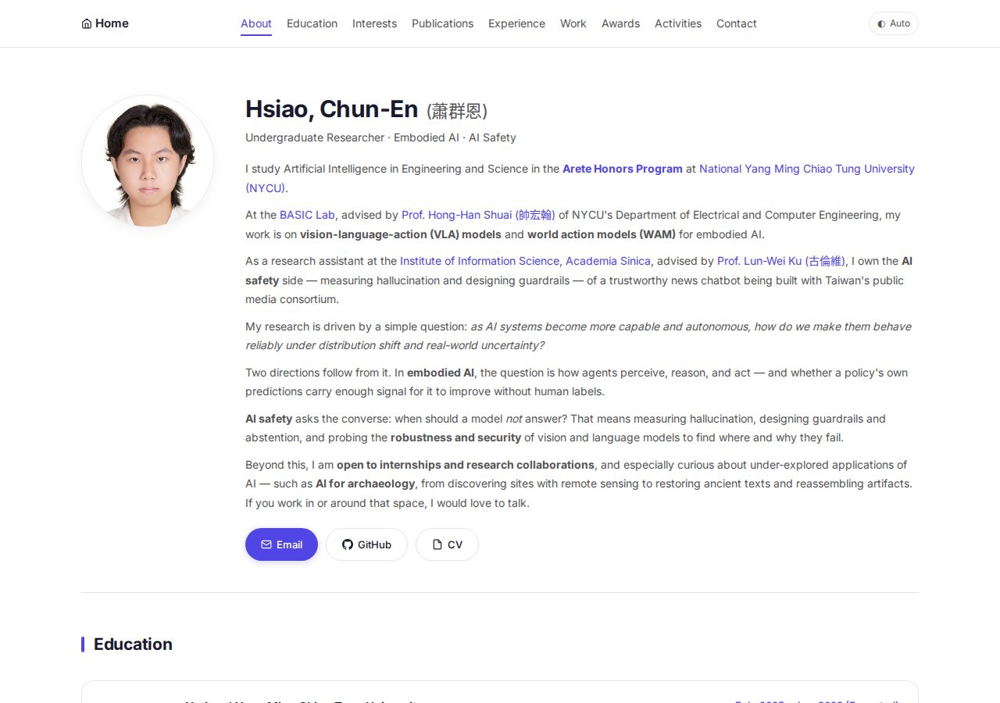
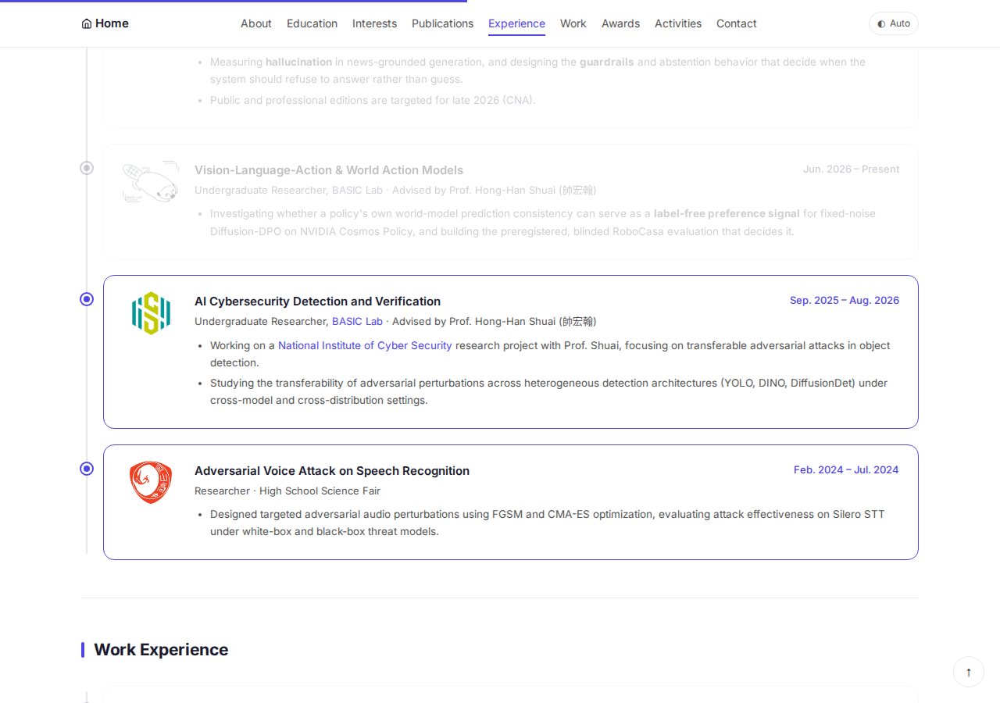
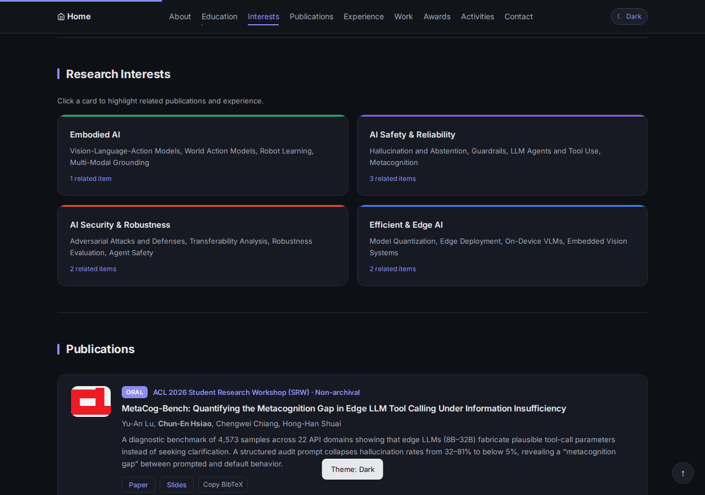
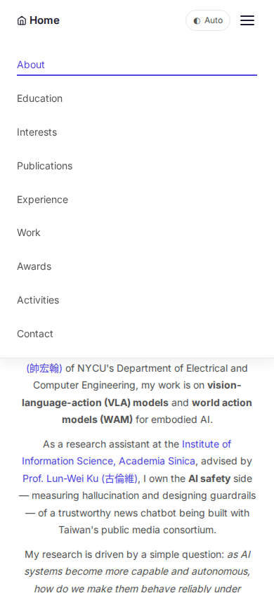

# 蕭群恩 個人學術網站 — 規格書

🔗 **網站：<https://xiaoce.me/>**（原址 <https://xiao-0001.github.io/> 會自動轉址）

用 Vibe Coding 跟 AI（Claude）一起做的單頁式個人學術網站。整個網站就是一個 `index.html`，CSS 和 JavaScript 都直接寫在裡面，用 GitHub Pages 公開。

---

## 一、動機與目標

我是做 AI 研究的大學部學生，申請實習、找研究合作、投稿的時候，需要一個能讓人很快看懂「我做什麼研究、做過哪些東西」的地方。
PDF 履歷看不出研究方向之間的關係，所以我想做一個能**互動**的網頁，讓訪客自己挑有興趣的研究方向，直接看到相關的論文和經歷。

## 二、目標使用者

教授、實驗室、業界招募人員、研討會上遇到的研究者。
這些人通常只會停留 30 秒左右，所以重點要一眼就能找到，**用手機看也要正常**。

## 三、頁面架構（單頁式，由上往下）

| 區塊 | 內容 |
|---|---|
| 導覽列 | 各區塊的錨點連結、主題切換鈕；手機版收成漢堡選單 |
| About | 照片、姓名、研究方向簡介，Email / GitHub / CV 按鈕 |
| Education | 學歷 |
| Research Interests | 四張研究方向卡片（Embodied AI、AI Safety、AI Security、Edge AI），**可點擊篩選** |
| Publications | 論文，附 Paper / Slides / Copy BibTeX |
| Research / Work Experience | 用時間軸呈現的研究與工作經歷 |
| Honors & Awards、Activities | 獲獎和課外活動 |
| Footer | 聯絡方式，附一鍵複製 Email |

## 四、互動功能規格

### F1 研究方向篩選

- 點一張研究方向卡片後：
  - 和這個方向相關的論文與經歷會**加上高亮外框**，其他項目**變淡**。
  - 頁面自動捲到第一筆相關項目。
- 每張卡片下方會自動算出並顯示「N related items」。
- 取消篩選有三種方式：再點一次同一張卡片、點「Show all」、按 `Esc`。
- 實作方式：每個經歷項目都標了 `data-tags`，由 JavaScript 比對卡片的 `data-filter`。

### F2 深色／淺色主題切換

- 導覽列右邊的按鈕，依序切換 **Auto → Light → Dark**。
- Auto 會跟著作業系統的設定走（`prefers-color-scheme`）。
- 選擇會記在 `localStorage`，重新整理後還在。在 `<head>` 就先套用主題，所以載入時不會先閃一下另一個主題。
- 切換後畫面下方會跳出提示。

### F3 閱讀進度與目前位置

- 頁面最上方有一條**閱讀進度條**。
- 捲動時，導覽列會自動標出目前所在的區塊（scroll-spy）。

### F4 一鍵複製

- 論文的「Copy BibTeX」會把引用格式複製到剪貼簿。
- Footer 的「Copy email address」可以複製 Email。
- 複製完會跳出 toast 提示。如果瀏覽器不支援 Clipboard API，會改用 fallback 的複製方式。

### F5 回到頂端

往下捲超過 600px 後，右下角會出現 ↑ 按鈕，按了會平滑捲回頁首。

### F6 響應式設計

手機寬度（390px）不會出現橫向捲軸，導覽列改成漢堡選單。

### F7 列印友善

列印時強制使用淺色，並隱藏進度條、按鈕、提示這些互動元件。

## 五、技術規格

- **單一 `index.html`**：CSS 和 JavaScript 都是 inline，沒有用任何框架或建置工具。
- 圖片、CV 和論文 PDF 是同一個 repo 裡的靜態檔案。
- 用 **GitHub Pages** 部署，綁定自訂網域 `xiaoce.me`（`CNAME` 檔加上 DNS A record，有 HTTPS）。
- SEO：meta description、Open Graph 分享卡片、JSON-LD、`sitemap.xml`、`robots.txt`。
- 無障礙：互動卡片用 `<button>` 搭配 `aria-pressed`，有鍵盤 focus 樣式，也支援 `prefers-reduced-motion`。

## 六、驗收標準（用無頭瀏覽器 Playwright 實測）

- [x] 點「AI Security」卡片：2 筆高亮、5 筆變淡；按 Show all 後全部恢復
- [x] 主題切到 Dark 後重新整理，仍然是 Dark
- [x] 捲到 Interests 區塊時，導覽列標示 Interests
- [x] 手機寬度 390px 沒有橫向溢出，漢堡選單可以展開
- [x] Console 沒有任何 JavaScript 錯誤

## 七、和 AI 反覆修改的過程

這個網站從 2026 年 3 月開始，跟 AI 一起來回改了 80 幾個 commit，完整紀錄都在 [commit history](https://github.com/xiao-0001/xiao-0001.github.io/commits/main)。幾個主要階段：

1. **3 月：初版與花俏期**。做出基本版面後，陸續加上漸層背景、動態色塊、游標粒子特效、打字機效果。中間也試過一次「進度條 + 深色模式」，覺得不合適就 revert 了。
2. **7 月：改走極簡學術風**。拿掉 vibe 特效，參考 Jon Barron 的學術個人頁重新設計；加入 Publications、實習經歷，整理研究方向；做一次全站 audit（手機選單、SEO、無障礙）。
3. **9 月：內容與細節打磨**。加中研院經歷、ECCV 得獎、機構 logo；調整版面寬度和斷行；加 SEO 分享卡片、深色模式、列印樣式、sitemap；最後搬到自訂網域 `xiaoce.me`。
4. **10 月（本次作業）**：依照作業規格，把 CSS 合進單一 `index.html`，並新增 F1–F5 的互動功能，用無頭瀏覽器逐項驗收。
